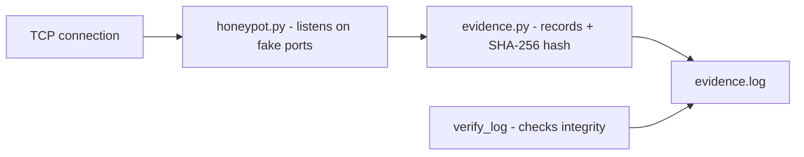

# honeypot-portas-evidencia

**English** · [Português (Brasil)](README.md)

[](#) [](#) [](LICENSE)

## What it is

A **TCP honeypot** that listens on **fake ports** on a local target and **records evidence** of each connection (IP, port, timestamp) with a **SHA-256 integrity hash** — letting you later **verify** whether the log was tampered with. It is an educational (defensive) security lab in pure Python.

## ⚠️ Ethical and legal use warning

Use it **only in your own controlled environments/networks and with authorization**. A honeypot records who approaches it; capturing/recording third-party traffic without permission may violate privacy/eavesdropping laws. Do not use it against systems you are not responsible for.

## Status

An educational security lab, working and tested (12 tests).

## Features

- **Honeypot server** (`honeypot.py`, class `Honeypot`): listens on fake ports and records connections.
- **SHA-256 evidence** (`evidence.py`): each connection record gets a deterministic hash (fixed field order), letting you **verify integrity** (`verify_log`).
- **Evidence log** (`EvidenceLog`): append + read records.
- **CLI**: `honeypot-portas-evidencia --host ... --port ... --log ... [--timeout S]`.

## Architecture

A `honeypot_portas_evidencia` package with `honeypot.py` (server) and `evidence.py` (integrity/log). The honeypot records each connection; the hash lets you detect later tampering.



## Stack

- Python ≥ 3.10, stdlib only (sockets, hashlib)
- pytest (dev)

## Repository layout

```
honeypot-portas-evidencia/
├── pyproject.toml · BRIEF.md
├── src/honeypot_portas_evidencia/
│   ├── honeypot.py   # honeypot server
│   └── evidence.py   # evidence + SHA-256 hash
├── tests/            # 12 tests
└── LICENSE           # MIT
```

## Prerequisites and installation

Python ≥ 3.10.

```bash
pip install -e .
```

## How to run

```bash
honeypot-portas-evidencia                       # listens on 127.0.0.1:2222, logs to evidence.log
honeypot-portas-evidencia --port 8080 --log my-evidence.log
```
(Defaults: `--host 127.0.0.1`, `--port 2222`, `--log evidence.log`, `--timeout 2.0`.)

## Tests and quality

Real command (verified by the agent):

```bash
PYTHONPATH=src python -m pytest tests/
# 12 passed
```

## Technical decisions and trade-offs

- **Per-record SHA-256 hash**: auditable integrity and detectable tampering; without encryption, it is an authenticity stamp.
- **Stdlib only**: light and dependency-free; the cost is a simple honeypot (no real service fingerprinting).

## Known limitations and roadmap

- Basic fake-port honeypot; it does not emulate real services (e.g. an SSH banner) to fool advanced scanners.
- Records connection metadata only, no payload capture.

## Development process

An individual project by Kelvin Oliveira, built with orchestrated AI agents and reviewed by the author. The hash-based evidence and the review are the author's.

## License and author

MIT — Copyright (c) 2026 Kelvin Rebelo de Oliveira.

**Author**: [Kelvin Oliveira](https://github.com/KelvinOliveiraCode) · [Portfolio](https://kelvinoliveiracode.github.io/portfolio/)
