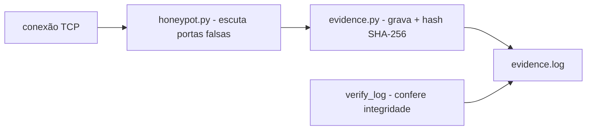

# honeypot-portas-evidencia

[English](README.en.md) · **Português (Brasil)**

[](#) [](#) [](LICENSE)

## O que é

**Honeypot TCP** que escuta **portas falsas** em um alvo local e **grava evidência** de cada conexão (IP, porta, timestamp) com um **hash SHA-256 de integridade** — permitindo depois **verificar** se o log foi adulterado. É um laboratório educacional de segurança (defensiva) em Python puro.

## ⚠️ Aviso de uso ético e legal

Use **apenas em próprios ambientes/redes controladas** e com autorização. Um honeypot registra conexões de quem se aproxima; capturar/registrar tráfego de terceiros sem permissão pode violar leis de privacidade/espionagem. Não use contra sistemas dos quais você não é responsável.

## Status

Laboratório educacional de segurança, funcional e testado (12 testes).

## Funcionalidades

- **Servidor honeypot** (`honeypot.py`, classe `Honeypot`): escuta portas falsas e registra conexões.
- **Evidência com hash SHA-256** (`evidence.py`): cada registro de conexão recebe um hash determinístico (ordem fixa de campos), permitindo **verificar a integridade** (`verify_log`).
- **Log de evidência** (`EvidenceLog`): append + leitura de registros.
- **CLI**: `honeypot-portas-evidencia --host ... --port ... --log ... [--timeout S]`.

## Arquitetura

Pacote `honeypot_portas_evidencia` com `honeypot.py` (servidor) e `evidence.py` (integridade/log). O honeypot grava cada conexão; o hash permite detectar adulteração posterior.



## Stack

- Python ≥ 3.10, stdlib apenas (sockets, hashlib)
- pytest (dev)

## Estrutura do repositório

```
honeypot-portas-evidencia/
├── pyproject.toml · BRIEF.md
├── src/honeypot_portas_evidencia/
│   ├── honeypot.py   # servidor honeypot
│   └── evidence.py   # evidência + hash SHA-256
├── tests/            # 12 testes
└── LICENSE           # MIT
```

## Pré-requisitos e instalação

Python ≥ 3.10.

```bash
pip install -e .
```

## Como executar

```bash
honeypot-portas-evidencia                       # escuta 127.0.0.1:2222, grava em evidence.log
honeypot-portas-evidencia --port 8080 --log meu-evidence.log
```
(Defaults: `--host 127.0.0.1`, `--port 2222`, `--log evidence.log`, `--timeout 2.0`.)

## Testes e qualidade

Comando real (verificado pelo agente):

```bash
PYTHONPATH=src python -m pytest tests/
# 12 passed
```

## Decisões técnicas e trade-offs

- **Hash SHA-256 por registro**: integridade auditável e detectável de adulteração; sem criptografia, é um carimbo de autenticidade.
- **Só stdlib**: leve e sem dependências; o custo é um honeypot simples (sem fingerprint de serviço real).

## Limitações conhecidas e roadmap

- Honeypot de portas falsas básico; não emula serviços reais (ex.: banner de SSH) para enganar scanners avançados.
- Sem captura de payload, apenas metadados de conexão.

## Processo de desenvolvimento

Projeto individual de Kelvin Oliveira, construído com agentes de IA orquestrados e revisado pelo autor. A evidência com hash e a revisão são do autor.

## Licença e autor

MIT — Copyright (c) 2026 Kelvin Rebelo de Oliveira.

**Autor**: [Kelvin Oliveira](https://github.com/KelvinOliveiraCode) · [Portfólio](https://kelvinoliveiracode.github.io/portfolio/)
